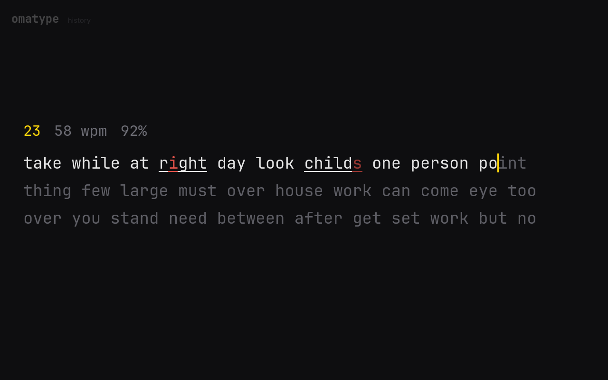
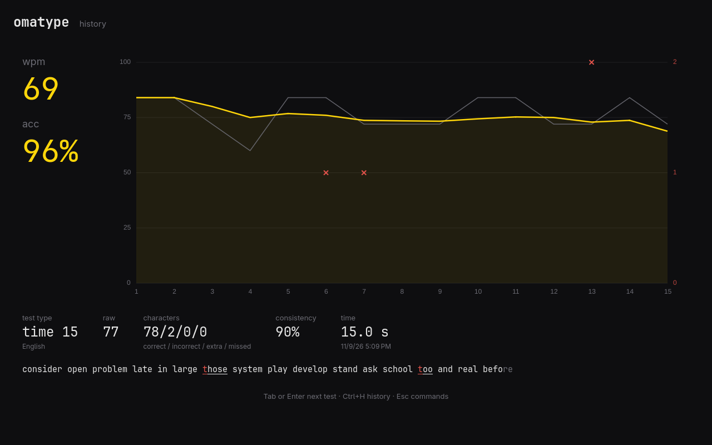
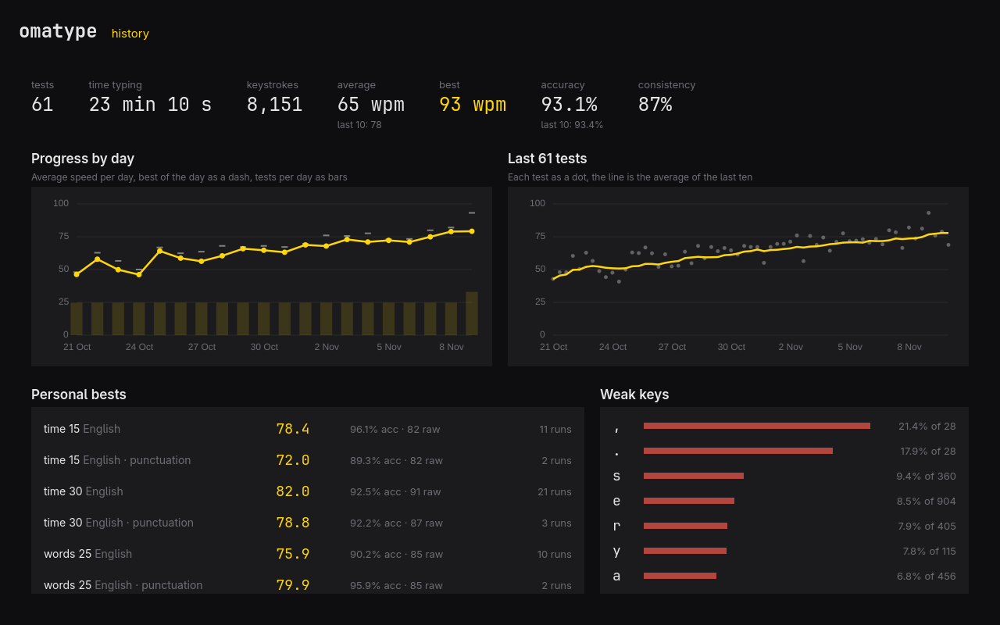

# omatype

> **Work in progress.** omatype is an early draft: it works and keeps your
> history, but expect rough edges, missing features, and changes to the stats
> and the database between versions. There is no release or package in
> Omarchy's repositories yet; build it from source.



A typing trainer for [Omarchy](https://omarchy.org) that keeps every keystroke
and turns them into stats. It runs offline, follows the Omarchy theme live
(light and dark), and is driven entirely from the keyboard.

- **Four modes**: time (15, 30, 60, 120 s), words (10, 25, 50, 100), quote
  (short, medium, long), and zen (type freely, Shift+Enter to end).
- **Options**: punctuation, numbers, stop on error (a wrong letter isn't
  accepted), confidence mode (no backspace). English or French words.
- **Stats**: net speed (wpm), raw speed, accuracy, consistency, and a graph of
  each test second by second with its errors.
- **History**: progress by day, the trend over the last 100 tests, personal
  bests for each kind of test, the keys you miss most, and every past test,
  graph included.





Screenshots use made-up practice data.

## Keys

| Key | Does |
| --- | --- |
| Tab | New test, from anywhere |
| Esc | Command palette: modes, options, history, quit |
| ↑ or Shift+Tab | Settings bar (before typing); ← → to move, Enter to pick |
| Backspace | Delete a letter; a wrong word can be reopened |
| Ctrl+Backspace | Delete the word |
| Shift+Enter | End a zen test |
| Enter | Next test, on the result screen |
| Ctrl+H | History and stats |
| ↑ ↓ Enter Delete | Pick, open, or remove a test in the history |
| F1 or Ctrl+/ | Every shortcut |
| Ctrl+Q | Quit |

`?` and `Q` are letters you may be typing, so help and quit use F1 and Ctrl+Q.

## How the numbers are made

A word is five characters. **wpm** counts the characters of correctly typed
words and the spaces after them; **raw** counts every keystroke. **Accuracy**
is the share of keystrokes that were right. **Consistency** maps the variation
of per-second raw speed to 0-100. Everything is computed from the saved
keystrokes, so an old test's graph is exactly what it was when it finished.

The history is a SQLite database at `~/.local/share/omatype/history.db`, and
settings are in `~/.config/omatype/settings.ini`.

## From the command line

```sh
omatype stats [--json]              # totals, personal bests
omatype history [--limit N] [--json]
omatype test <id> [--json]          # one test with its per-second series
omatype skill install               # an agent skill for reading your stats
```

## Building

The typing rules, statistics, and history live in a Rust library
(`engine/`), linked into a C++ and Qt Quick app (`src/`).

```sh
bin/build      # cargo + qmake6 + make into build/omatype
bin/test       # engine tests, then the Qt tests offscreen
bin/install    # builds and installs the Arch package, so it's in the launcher
```

Needs `rust`, `qt6-base`, `qt6-declarative`, `qt6-wayland`, and `sqlite`.

## License

MIT. Theme, translation, and command-line patterns follow Omacut, Monologue,
and Hype by David Heinemeier Hansson.
